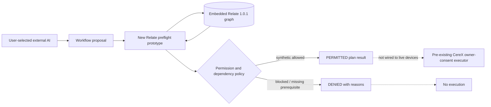
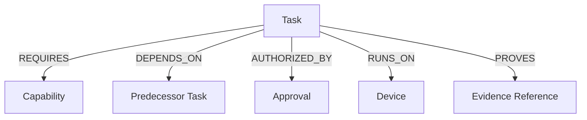

# Architecture — CereX Local Context Graph

This is the new **Relate 1.0.1 preflight** prototype created for the hackathon. It runs read-only Cypher on a **synthetic** local persistent graph. It does not execute real computer commands. The original CereX remote agent is a separate pre-existing product.

## System boundaries



The dotted edge deliberately denotes a **future integration only**. The preflight output is a planning decision, **not** a real execution authorization.

## Graph relationships



The graph captures six dependency edges, five node categories and eight synthetic tasks. Preflight runs six fixed read-only Cypher queries to inspect graph state. Cases cover explicit approval, device capability allowlisting, denied network operations, unrestricted shell access, missing predecessors, and propagation of failed prerequisites.

## Trust boundaries

- The actual Relate store is `judge-graph.rl` (single-file, persisted) and its synthetic genesis data is in `fixture.json`.
- `engine.py` opens the store read-only and produces inspectable task decisions.
- `api.py` accepts only fixed read endpoints; it cannot run arbitrary Cypher, OS commands, or modify the store.
- No customer, employer, or personal machine data is used in the synthetic fixture.
- The hosted demo is an explanatory prototype. It is neither the live CereX permission enforcement point nor proof of PC control.
- The pre-existing CereX application is not part of the competition source repository.

## Judge reproduction

Run:

```bash
python3 -m venv .venv
.venv/bin/python -m pip install -r requirements.txt
.venv/bin/python -m unittest discover -s tests -v
.venv/bin/python engine.py
```

Public working demonstration: https://cerex.site/judge/relate-live/

Full submission text: [DEVPOST_SUBMISSION.md](DEVPOST_SUBMISSION.md).
